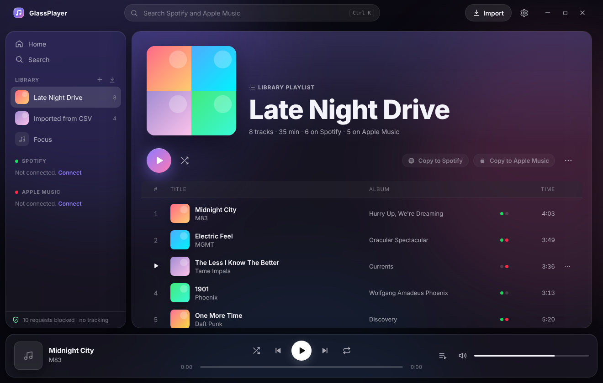

# GlassPlayer

A clean, glassy desktop player for **Spotify** and **Apple Music** in one window.



- **One queue for both services.** Mix Spotify and Apple Music tracks in the same playlist. Each track plays on whichever service has it; if it's missing, GlassPlayer finds it on the other service (ISRC first, then title, artist and length).
- **Playlist imports**
  - Your Spotify playlists and Liked Songs, and your Apple Music library playlists, appear in the sidebar → **Save to Library**
  - Paste a Spotify or Apple Music **playlist or album link**
  - **Files**: CSV (Exportify, TuneMyMusic, Soundiiz…), M3U/M3U8, JSON, or plain `Artist - Title` text
  - **Copy between services**: Spotify → Apple Music and Apple Music → Spotify, with a list of anything that couldn't be matched
  - Export any playlist as CSV or M3U
- **Discord Rich Presence.** Shows *Listening to* with the song, artist, cover art, a live progress bar and an "Open in Spotify / Apple Music" button. It talks straight to the Discord app's local socket, with no third-party library.
- **Glass UI.** Native vibrancy on macOS, acrylic on Windows 11, a blurred album-art backdrop, and an accent glow that follows the cover art. Queue panel, context menus, drag-and-drop, media keys, keyboard shortcuts.

## No ads, no bloat, no spyware

This is enforced in code, not just promised:

| | |
|---|---|
| **Zero runtime dependencies** | The only npm packages are Electron and the build tool. No analytics SDKs, no crash reporters, no auto-updater. |
| **Network allowlist** | `main/network-guard.js` blocks every request that isn't going to Spotify or Apple. It also blocks Apple's analytics host (`xp.apple.com`). |
| **Live network log** | Settings → Privacy lists every host the app has contacted, with allowed and blocked counts. |
| **No servers of ours** | You use your own Spotify app ID and Apple key. Login goes directly between you and Spotify/Apple. |
| **Encrypted credentials** | Tokens and your Apple key are encrypted with the OS keychain (`safeStorage`). The app refuses to save them in plain text. |
| **Locked-down renderer** | `contextIsolation`, `sandbox`, no Node in the page, a strict CSP, navigation blocked, every permission denied except DRM playback. |

Your playlists and settings are plain JSON files in your user-data folder (shown in Settings → Privacy).

## Requirements

- **Spotify**: playback needs **Spotify Premium** (it uses Spotify's Web Playback SDK). Browsing, importing and copying playlists work on any account.
- **Apple Music**: needs an Apple Music subscription, plus a **MusicKit developer key**. Apple requires one for any third-party Apple Music app, and getting one requires an Apple Developer Program membership.
- **Discord** (optional): the Discord desktop app running on the same computer.
- Node.js 20+ to build.

## Getting started

```bash
npm install     # pulls castlabs Electron, which includes Widevine DRM
npm start
```

### 1. Spotify (about 2 minutes)
1. Go to <https://developer.spotify.com/dashboard> → **Create app**.
2. Tick **Web API** and **Web Playback SDK**.
3. Add the Redirect URI **`http://127.0.0.1:8888/callback`**.
4. Copy the **Client ID** into GlassPlayer → Settings → Spotify, then press **Connect**. No client secret is needed (the app uses PKCE).

> A new Spotify app starts in *Development mode*, which only works for accounts you add under **User Management** in the dashboard. That's fine for personal use.

### 2. Apple Music
1. Go to <https://developer.apple.com/account/resources/authkeys/list> and create a key with **Media Services (MusicKit)**.
2. In Settings → Apple Music, enter your **Team ID** and **Key ID**, then choose the `.p8` file. GlassPlayer signs developer tokens locally with that key, and the key never leaves your computer.
   *Or* paste a developer token you already have.
3. Press **Sign in to Apple Music**.

### 3. Discord presence
1. Go to <https://discord.com/developers/applications> → **New Application**. Name it **GlassPlayer**, since that name is what friends see.
2. Copy the **Application ID** into Settings → Discord and turn it on.

## Keyboard

| Key | Action |
|---|---|
| `Space` | Play / pause |
| `Ctrl/⌘ ←` `→` | Previous / next |
| `Shift ←` `→` | Seek ±10 s |
| `Ctrl/⌘ ↑` `↓` | Volume |
| `Ctrl/⌘ K` | Search |
| `Ctrl/⌘ ,` | Settings |

## Building installers

```bash
npm run dist    # DMG on macOS, NSIS on Windows, AppImage/deb on Linux
```

Spotify and Apple streams are DRM-protected (Widevine). On **Windows and macOS**, Widevine only trusts builds signed through castlabs' free EVS service. Sign the packaged app before you ship it to other people:

```bash
pip install castlabs-evs
python -m castlabs_evs.account signup         # once
python -m castlabs_evs.vmp sign-pkg dist/<platform-unpacked-dir>
```

On Linux, and while developing with `npm start`, no signing is needed.

## Project layout

```
main/
  main.js            window, custom app:// protocol, IPC, permissions
  network-guard.js   request allowlist + network log
  discord-rpc.js     dependency-free Discord IPC client
  spotify-auth.js    PKCE login with a one-shot loopback server
  apple-token.js     local ES256 signing of MusicKit developer tokens
  store.js           settings/library JSON + encrypted secrets
  preload.js         the renderer's only bridge to the OS
renderer/
  index.html, styles.css
  js/app.js          views, sidebar, now-playing bar
  js/player.js       unified two-engine queue
  js/importer.js     CSV/M3U/text/URL parsing, matching, export
  js/dialogs.js      settings, import, transfer
  js/providers/      spotify.js (Web API + Playback SDK), apple.js (MusicKit v3)
test/                node --test unit tests
```

```bash
npm test         # parsers, matching, player queue, Discord framing, JWT signing, network guard
npm run check    # syntax-check every source file
```

## Troubleshooting

- **"Spotify playback needs a Premium account"**: the Web Playback SDK only streams for Premium users.
- **"Spotify player did not start"**: you're probably running stock Electron instead of the castlabs build. Reinstall with `npm install`.
- **A sign-in page won't load**: check Settings → Privacy → network log for a blocked host. Turn off *Strict network mode* to test, and open an issue with that host so it can be added to the allowlist.
- **Discord shows nothing**: Discord needs to be the desktop app, and *Display current activity* must be on (Discord → Settings → Activity Privacy).

## License

MIT
